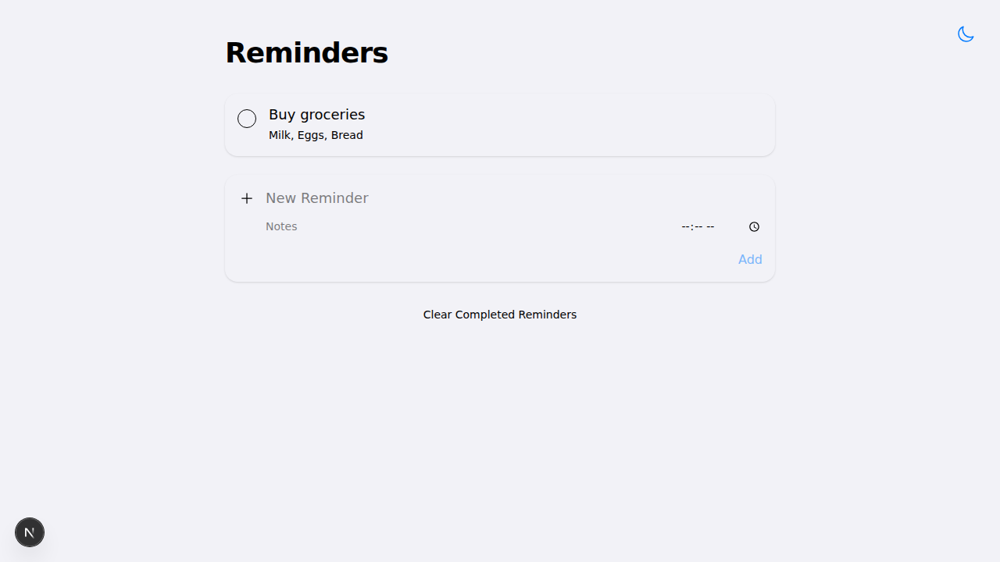
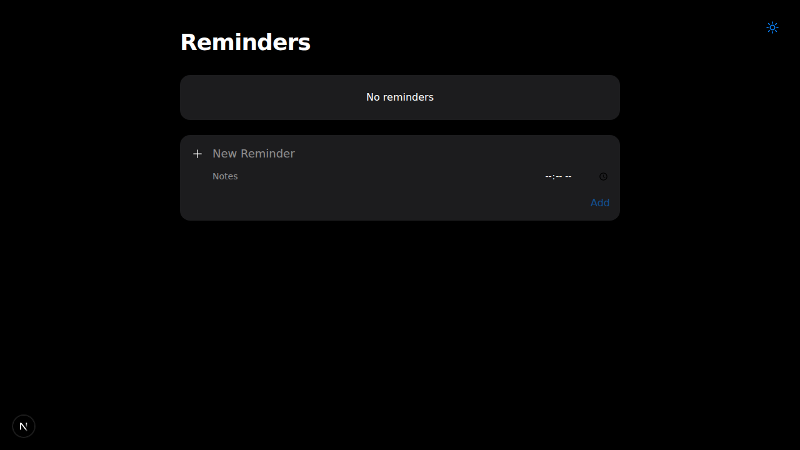

# ✨ Reminders

<div align="center">


### 🎯 *Turn chaos into clarity*

**A beautiful, responsive todo list application inspired by Apple Reminders.**

[🚀 Getting Started](#getting-started) • [🛠️ Contributing Guide](#getting-started-for-contributors) • [✨ Features](#features) • [🛠️ Tech Stack](#tech-stack)

</div>

---

## 📖 About

**Reminders** is a sleek and intuitive task management application that helps you organize your daily activities with style. Built with modern React and Next.js, it features a clean, minimalist design inspired by Apple Reminders, persistent storage, and a delightful user experience that makes productivity enjoyable.

> **Perfect for:** Students, professionals, and anyone who wants to stay organized with a clean, professional interface that doesn't compromise on functionality.

## 🖼️ Preview

<div align="center">

### Light Mode


### Dark Mode


*The clean, minimalist interface with a responsive layout and robust dark mode.*

</div>

## ✨ Features

### 🎨 **Clean & Professional Design**
- 🌟 Apple Reminders inspired minimalist UI.
- 📱 Fully responsive design for all devices.
- 🌙 Robust Light and Dark mode using Tailwind CSS v4.
- ✨ Smooth animations and transition effects.

### 📝 **Task Management**
- ➕ Add tasks with a title, description, and time.
- ✏️ Edit existing tasks inline.
- ✅ Mark tasks as complete/incomplete via circular checkboxes.
- 🗑️ Delete individual tasks.
- 🧹 Clear all completed tasks effortlessly.
- 🚫 Duplicate task prevention.

### 💾 **Smart Storage**
- 🔄 Automatic `localStorage` persistence.
- 💡 Tasks survive browser refreshes.
- 🎯 Real-time updates across sessions.

### 🎪 **User Experience**
- ⚡ Lightning-fast performance with Next.js.
- ⚠️ Smart error handling.

## 🚀 Getting Started

### 📋 Prerequisites

Make sure you have the following installed:
- **Node.js** (version 18.0 or higher)
- **npm**, **yarn**, **pnpm**, or **bun**

### ⚡ Quick Start

1. **Clone the repository**
   ```bash
   git clone https://github.com/Pritamx4/todolist.git
   cd todolist
   ```

2. **Install dependencies**
   ```bash
   npm install
   ```

3. **Start the development server**
   ```bash
   npm run dev
   ```

4. **Open your browser**
   
   Navigate to [http://localhost:3000](http://localhost:3000) to see your Reminders app in action! 🎉

### 🏗️ Build for Production

```bash
npm run build
npm run start
```

## 🛠️ Tech Stack

<div align="center">

| Technology | Purpose | Version |
|:----------:|:-------:|:-------:|
|  | **Framework** | 15.5.9 |
|  | **UI Library** | 19.1.0 |
|  | **Styling** | 4.1.13 |
|  | **Icons** | 2.2.0 |
|  | **Language** | ES2022+ |

</div>

## 🛠️ Getting Started for Contributors

Want to contribute and add new features? Here's your complete guide to get up and running:

### 🚀 Quick Setup for Development

1. **Fork & Clone the repository**
   ```bash
   # Fork the repo on GitHub first, then:
   git clone https://github.com/YOUR_USERNAME/todolist.git
   cd todolist
   ```

2. **Install dependencies**
   ```bash
   npm install
   ```

3. **Start the development server**
   ```bash
   npm run dev
   ```
   🎉 Your development server is now running at `http://localhost:3000`

4. **Start coding!**
   - Main app logic: `app/page.js`
   - Styling: `app/globals.css` and TailwindCSS classes
   - Layout & metadata: `app/layout.js`

### 🔧 Development Workflow

```bash
# Create a new feature branch
git checkout -b feature/your-awesome-feature

# Make your changes and test them
npm run build  # Test production build
npm run dev    # Test in development

# Commit your changes
git add .
git commit -m "Add awesome new feature"

# Push to your fork
git push origin feature/your-awesome-feature

# Create a Pull Request on GitHub
```

### 💡 Feature Ideas to Get Started

Looking for inspiration? Here are some features you could add:

- 🏷️ **Task Categories/Tags** - Organize tasks by lists or tags.
- ⏰ **Reminders/Notifications** - Add browser push notifications for tasks with set times.
- ☁️ **Cloud Sync** - Persist data to a database like Firebase, Supabase, or MongoDB.
- 📱 **PWA Support** - Make it installable as a mobile app.
- 🔍 **Search & Filter** - Find tasks quickly.

## 🤝 Contributing

We love contributions! Here's how you can help make this todo list even more awesome:

### 🐛 Found a Bug?
1. Check if it's already reported in [Issues](https://github.com/Pritamx4/todolist/issues)
2. If not, create a new issue with:
   - Clear description of the problem
   - Steps to reproduce
   - Expected vs actual behavior
   - Screenshots if applicable

### 📝 Code Style
- Follow the existing code style.
- Use meaningful commit messages.
- Test your changes thoroughly.

## 🌟 Show Your Support

If you find this project helpful, please consider:

- ⭐ **Star** this repository
- 🍴 **Fork** it for your own projects
- 📢 **Share** it with friends and colleagues
- 🐛 **Report** any issues you find
- 💡 **Suggest** new features

---

<div align="center">

### 🎉 Made with ❤️ and lots of ☕

**Happy organizing! ✨**

### 🔗 Connect & Follow

[](https://github.com/Pritamx4)

</div>

---

<div align="center">

*⭐ If this project helped you stay organized, please consider giving it a star! ⭐*

</div>
